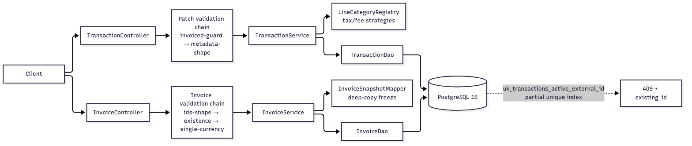

# ARCHITECTURE — Navan Commerce Transactions & Invoices

> Take-home B: flight / hotel / rail / Navan-fee transactions + frozen-snapshot invoices.
> Java 17 · Spring Boot 3 · Spring Data JPA · PostgreSQL 16 · Flyway.
> Full DDL and index list: `DB_SCHEMA.md`. Wire contract with real samples: `API_CONTRACT.md`.

---

## 1. High-Level Diagram



Two writes that matter, and what guards them:

```text
POST /transactions            POST /invoices
  │ build header + lines        │ validate ids → 400/404/409
  │ INSERT (hits unique index)  │ deep-copy snapshot lines
  └─► duplicate? → 409+id       └─► one commit → frozen forever
```

---

## 2. Design Decisions — Alternatives Considered, and Why

### 2.1 Money lines on transactions: relational, category-discriminated table

**Chosen:** one `transaction_lines` table for taxes **and** fees, discriminated by `category`.
Fields common to every category (`name`, `amount`) are real typed columns; category-specific
fields (the tax `rate` today, a promo code tomorrow) live in an `attributes` JSONB column.
The API still exposes `tax_lines` / `fee_lines` as separate lists — mappers split by category.

**Why:** transactions are **mutable** (PATCH can rewrite line lists) and they are the
**system of record for analytics** ("total VAT collected in March", "YQ per carrier") — so
the values we aggregate on must be queryable typed columns, not buried in a document. The
merged-table shape means a new line category (e.g. `discount`) is **one enum value + one
strategy class, zero migrations**, instead of a new table.

**Alternatives rejected:**

| Alternative | Why not |
|---|---|
| Lines inside the `metadata` JSONB blob | We would lose aggregation and analytics — SQL over JSONB arrays is slow, unindexable per-row, and every total becomes unrolling. Money must be real columns. |
| Separate `tax_lines` and `fee_lines` tables | Identical shapes today; two tables, two repositories, two of everything — and the third category still forces a migration. One discriminated table carries all three. |
| Document DB for transactions (whole document per write, fetched by id) | We do always read a transaction whole — but we would lose: atomic multi-row writes (header + lines + duplicate-guard in one commit), the **partial unique index** that makes concurrent duplicate POSTs safe, `NUMERIC` money semantics, and cheap pagination/analytics. Adding a second datastore is operational complexity (backups, consistency, migrations) for zero query we actually need. |

### 2.2 Money lines on invoices: the opposite choice — JSONB

**Chosen:** `invoice_lines.breakdown` JSONB — the frozen `{"tax_lines": [...], "fee_lines": [...]}`
document, typed in code as `List<LineItem>` via `LineBreakdownConverter`.

**Why the asymmetry is deliberate:** an invoice is **immutable by rule** — write-once,
read-whole, never patched field-by-field. Relational child rows would buy nothing: no
per-row updates, no joins, no constraints to enforce. And there is **no analytics loss**:
the accurate, queryable data already lives in `transaction_lines` (2.1) — the invoice copy
is a legal record, not a reporting source. Keeping the split inside the line row also means
one invoice read = header + N line rows, no third fetch level.

**Alternatives rejected:**

| Alternative | Why not |
|---|---|
| Relational `invoice_line_breakdown` table | A third table to join on every invoice read, enforcing constraints on rows that can never change — pure cost. |
| Live join to `transactions` at read time | Violates the core rule: editing a transaction must never change a billed invoice. Snapshots are physical copies; reads never touch `transactions`. |

### 2.3 Metadata: JSONB column + sealed Java hierarchy

**Chosen:** shared `transactions` table with a `metadata JSONB` column, deserialized into a
sealed polymorphic model (`TransactionMetadata` ↔ `Flight/Hotel/Rail/NavanFee`) selected by
the sibling `type` property (Jackson `EXTERNAL_PROPERTY`).

**Why:** metadata is round-tripped in full but **never filtered or joined on** — the spec
explicitly allows JSON for type-specific fields as long as taxes/fees/identity are real
columns (they are, 2.1). The sealed model keeps it type-safe: a flight can never be stored
or patched as a hotel blob (mismatched shape → 400). Adding a transaction type = one enum
value + one metadata class — no DDL.

**Alternatives rejected:**

| Alternative | Why not |
|---|---|
| Child tables per type (`flight_coupons`, `rail_legs`, …) | More joins per read, more DDL per type, same query power — we never run `WHERE coupon.flight_number = ?`. Right call only if that query appears. |
| STI (one wide table) | Sparse nullable columns, weakest typing, painful evolution. |
| Document DB | Same argument as 2.1 — and metadata is only one part of the record. |

### 2.4 Identity & duplicate creates: the database is the guard

**Chosen:** partial unique index `UNIQUE(external_id) WHERE deleted_at IS NULL`. No
check-then-act in code. Two overlapping POSTs serialize on the index entry; the loser
catches the violation and reads the winner's id in a fresh transaction → **409 + existing
id** (spec lets us pick 409 or 200; 409 is explicit and never silently "succeeds").

**Alternatives rejected:** app-level existence check (races under concurrency — exactly the
failure the spec tests), `SELECT … FOR UPDATE` / advisory locks (serialization point we
don't need — the index entry *is* the lock), upsert (returns 200 and hides client retries
vs. true duplicates; we chose explicit conflict).

### 2.5 Soft delete vs hard delete

**Chosen:** **soft delete** (`deleted_at`) on the two aggregate roots only.

**Why:** these are **financial records** — a hard DELETE destroys the audit trail, and the
first question an auditor asks is "*when* was this voided" (`deleted_at` answers it for
free). It also composes with uniqueness: the partial unique index (2.4) means a deleted
`external_id` doesn't block re-creation — *deleted = does not exist*, but the row remains
for audit. Deletes are one versioned UPDATE — atomic, and `@Version` still rejects
concurrent PATCH/DELETE losers with 409.

**Alternatives rejected:** hard delete (loses audit; and `ON DELETE CASCADE` would destroy
line history with it); an `active BOOLEAN` flag (strictly worse — same filtering burden, no
timestamp); archive tables (moves the complexity into every read path — unions or dual
queries — for a volume this service will not see).

The cost — every query must filter `deleted_at IS NULL` — is contained by making the **DAO
the single query-composition point**: repositories expose only `…AndDeletedAtIsNull`
derived queries, and the partial indexes carry the same predicate, so deleted rows neither
leak nor bloat lists.

### 2.6 Smaller documented decisions

| # | Decision | Choice | Why |
|---|---|---|---|
| D1 | Stack | Java 17 · Spring Boot 3 · JPA · **PostgreSQL 16** | Spec-preferred stack; Postgres for native **partial indexes** (soft-delete-aware uniqueness), JSONB, TIMESTAMPTZ |
| D5 | Money | `NUMERIC(19,2)` / `BigDecimal` scale 2, HALF_EVEN (all rounding in `MoneyUtils`); DTOs bound magnitude so overflow → 400 | No IEEE float near totals. Limitation: assumes 2-minor-unit currencies — extension = currency table, no schema reshape |
| D6 | Server ids | Prefixed UUIDs `txn_…` / `inv_…` | No sequence contention under concurrent create; self-describing in logs |
| D7 | Enums on the wire | Exact lowercase canonical values only; anything else → 400 `UNKNOWN_TYPE` / `UNKNOWN_FEE_KIND` | One canonical form on the wire and at rest — no alias drift |
| D8 | Invoice rollups | Derived **at read time from the snapshot**, taxes grouped by `(name, rate)`, fees by `name` | Frozen by construction; zero rollup rows to keep consistent |
| D9 | Same id twice on an invoice | 409 | Never silently double-count |
| D10 | `limit=1000` | 400 (valid 1–100, default 50) | Surface client bugs instead of hiding them |
| D11 | Concurrency | `@Transactional` boundaries + `@Version` optimistic locking; spec forbids Redis/Kafka/locks | Postgres suffices at this scale; loser gets retryable 409 |

---

## 3. Metadata Structure

```text
TransactionMetadata (sealed — selected by the "type" property)
├── FlightMetadata    origin, destination, fare, coupons[]
│                     └── Coupon: flight_number, carrier?, from, to, departure, arrival
├── HotelMetadata     name, address{street, city, country}, check_in, check_out,
│                     nights, room_rate_per_night, extras[]? (Extra: name, amount)
├── RailMetadata      legs[] (non-empty)
│                     └── Leg: origin, destination, departure, arrival, train_number?, class?
└── NavanFeeMetadata  fee_kind (trip_fee | agent_call_fee), description?, related_external_id?
```

- **Round-trip rule:** what you POST is what GET returns — coupons, legs, hotel address, `fee_kind` come back typed, never an empty blob.
- **Shape is enforced twice:** Jackson picks the subtype from `type` on create (mismatch → 400), and `MetadataValidator` re-parses PATCH bodies against the **stored** type (a flight cannot become a hotel).
- **Strict by default:** unknown fields anywhere → 400 (`fail-on-unknown-properties`), e.g. `rate` on a *fee* line, or `"class"` sent as `"travelClass"`.

---

## 4. Design Patterns — What Each One Solves

| Pattern | Where | What it solves |
|---|---|---|
| **Strategy + Registry** (Spring list-injection) | `LineCategoryStrategy` per line category, `LineCategoryRegistry` | One class owns a category's wire→entity→response→rollup logic. A new category (discount, surcharge) = **one new `@Component`** — no if/else chains, no edits in five places (OCP). |
| **Polymorphic deserialization** (Jackson `EXTERNAL_PROPERTY`) | `TransactionMetadata` subtypes | The metadata subtype is driven by the sibling `type` field — a flight can never deserialize as a hotel. Type safety without a hand-written dispatcher. |
| **Chain of Responsibility** | `validation/invoice/*`, `validation/patch/*` | Business rules as ordered, individually-testable handlers (ids-shape → existence → currency; invoiced-guard → metadata-shape). New rule = one handler with an `order()`, failure persists nothing. |
| **Snapshot (as a mapping seam)** | `InvoiceSnapshotMapper` | The freeze is one explicit deep-copy transformation — the only place "current transaction" becomes "billed line". |
| **Repository + DAO layering** | `dao/` is the only package touching `repository/` | Single query-composition point — this is what makes the soft-delete filter *un-forgettable* and keeps N+1 out (one `IN` query per level). |
| **Optimistic locking** | `@Version` on every entity | Overlapping PATCH/DELETE can never tear a row; loser gets a retryable 409 — no pessimistic locks held across HTTP. |
| **Fail-fast boundary + one error envelope** | Jakarta/Jakarta validation + `ErrorCode` enum + `GlobalExceptionHandler` | Every error — validation, business, framework, unexpected — renders the same JSON shape; 4xx always carries a reason, 5xx never leaks internals. |

---

## 5. Project Structure

```text
src/main/java/com/navan/commerce/
├── constant/      # compile-time literals: types, fee kinds, id prefixes, pagination bounds,
│                  #   validation patterns (currency, amount range), error keys
├── config/        # JpaConfig (@EnableJpaAuditing), JacksonConfig (IST instant rendering),
│                  #   OpenApiConfig — wiring only
├── controller/    # routing + status codes only: Transaction, Invoice, Health
├── dto/           # wire DTOs: CreateTransactionRequest, PatchTransactionRequest,
│                  #   CreateInvoiceRequest (transaction_ids; camelCase alias accepted),
│                  #   TransactionResponse, InvoiceResponse, InvoiceLineResponse,
│                  #   PageResponse, LineItem, TaxLineEntry / FeeLineEntry
├── domain/        # TransactionType, FeeKind, LineCategory (strict canonical @JsonCreator)
│   ├── metadata/          # sealed TransactionMetadata ↔ Flight/Hotel/Rail/NavanFee
│   └── metadata/support/  # Coupon, Leg, Address, Extra
├── entity/        # JPA entities 1:1 with DB_SCHEMA.md; BaseEntity (assigned id, @Version,
│                  #   audit; Persistable.isNew() keeps creates as plain INSERTs);
│                  #   AttributeConverters store canonical lowercase enum values
├── repository/    # Spring Data interfaces — only dao/ may touch them
├── dao/           # TransactionDao, InvoiceDao — the ONLY query-composition point;
│                  #   every read filters deleted_at IS NULL; invoiced-guard lives here
├── service/       # TransactionService / InvoiceService interfaces + impl/
│   └── line/      # LineCategoryStrategy per category + LineCategoryRegistry
├── validation/    # Chain of Responsibility per flow + MetadataValidator (PATCH shape check)
├── mapper/        # TransactionMapper, InvoiceMapper, InvoiceSnapshotMapper (the freeze)
├── exception/     # ErrorCode enum + ApiException subtypes + GlobalExceptionHandler
└── util/          # IdGenerator, MoneyUtils, OffsetPageRequest (true LIMIT/OFFSET Pageable)
```

**Package rules (enforced in review):**
- `controller` → `service` interfaces only; never `repository`/`dao`/`entity`.
- `service` → `dao`, `mapper`, `validation`, `util`; never HTTP types.
- `dao` → the only package that touches `repository`.
- `entity` never leaves `dao`/`service` without passing through `mapper`.
- `exception` is the single source of error truth — no controller builds error bodies by hand.

---

## 6. High Scale — What These Decisions Buy Us

What breaks first under load, and where the current design holds:

| Pressure point | What the design does today | Headroom |
|---|---|---|
| **Unbounded list scans** | Every list is `LIMIT/OFFSET` over partial composite indexes (`(created_at, id) WHERE deleted_at IS NULL`); `limit` capped at 100 | Smooth to **millions of rows** per table. Deep offsets degrade linearly — `PageResponse` already hides offset vs cursor, so cursor paging is an *additive* change |
| **Duplicate-POST storms** | Unique-index entry serializes only the conflicting pair; loser pays one blocked insert + one indexed lookup | Constant cost per conflict at any concurrency — no lock service, no retry amplification |
| **Invoiced-guard on hot PATCH/DELETE** | `SELECT EXISTS` over `idx_invoice_lines_txn` + invoice PK — O(log n) | Independent of invoice-table size |
| **GET by id** | PK lookup + one indexed `IN` per child level; entities are flat (no ORM associations, no lazy loading) → no N+1 ever | Read cost is O(page size), not O(table size) |
| **PATCH line replacement** | Bulk delete + insert in one transaction; per-transaction line counts are tiny and constant | Bounded write amplification |
| **Invoice reads** | Header + line rows only; breakdowns ride inside line rows (JSONB) — no third fetch, no live joins | An invoice read never gets slower as `transactions` grows |
| **Analytics over money lines** | `amount`/`name` are typed columns — `SUM`/`GROUP BY` are plain indexed SQL | Straightforward to add a read replica or roll-up reporting tables without touching the OLTP path |
| **Overlapping writers** | `@Version` optimistic locking; no pessimistic locks held across HTTP | Throughput scales with connection pool; losers retry cheaply |

**Where the ceiling is (honest):** single-writer Postgres on one node — tens of thousands of
writes/minute is comfortable for this row shape; beyond that the levers are read replicas
(lists/GETs), partitioning `transaction_lines` by `transaction_id` hash, and moving
analytics to a reporting pipeline. Nothing in the schema or API shape blocks any of those —
that's the point of keeping money relational and snapshots immutable.

**Deliberately not added** (spec): Redis, Kafka, lock managers, Prometheus/nginx.

---

## 7. Configuration

`application.yaml` holds environment-neutral defaults (datasource via env vars, JPA
`ddl-auto=validate`, Flyway enabled, Jackson: snake_case wire format, ISO-8601 timestamps
rendered in IST via `JacksonConfig`, plain BigDecimal, reject unknown fields, JDBC time zone
Asia/Kolkata). `application-dev.yaml` points at the local Docker Postgres (port 5433), app on
8089. `application-test.yaml` (test scope) points at the same Docker Postgres, database `test`
— auto-created by `TestDatabaseInitializer`, migrated by Flyway, truncated between tests:
integration tests exercise the real partial unique index and real SQL. Schema lives only in
Flyway (`V1__init.sql` mirrors `DB_SCHEMA.md`); Hibernate validates, never creates.
